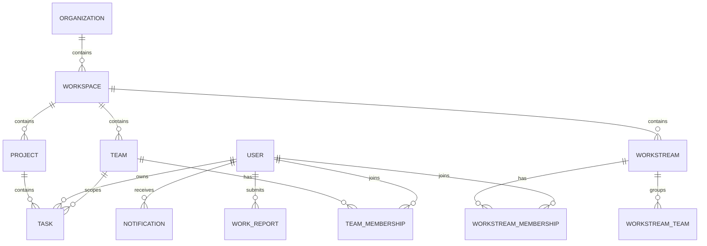

# Inhub Workspace — Firestore Database Schema

**Status:** Draft v1.1 — Modules 4 and 9 proposed extensions
**Database:** Cloud Firestore  
**Schema style:** Top-level collections with explicit organisation/workspace references

---

## 1. Schema objectives

The data model must support:

- A single Inhub organisation initially, with a workspace abstraction that can support additional workspaces later.
- Three global roles: Admin, Lead and Team Member.
- Lead scope across one or more workstreams and teams.
- Members assigned to one or more teams/workstreams where authorised.
- Projects and tasks with clear accountability and collaboration.
- Daily work reports with review history.
- In-app notifications and email delivery tracking.
- Append-only audit history.
- Server-side authorization and efficient scoped queries.

This schema is a proposed baseline. Confirm open product decisions before production data migration or schema lock-in.

## 2. Modelling conventions

- Document IDs: Firestore-generated IDs unless a deterministic ID is needed for uniqueness/idempotency.
- References: store IDs (`workspaceId`, `teamId`, `userId`) rather than deeply nested copies of full documents.
- Timestamps: use Firestore `Timestamp` in UTC; store date-only values as ISO `YYYY-MM-DD` strings in the organisation's configured timezone.
- Status: use controlled string unions and validate on the server.
- Soft deletion: prefer `archived`, `deactivatedAt` or status fields over hard deletion for business records.
- Arrays: keep small bounded arrays only. For memberships, comments, activity, dependencies and delivery attempts, use dedicated documents/subcollections.
- Server ownership: fields such as role, status, permission scope, audit metadata and delivery state are writable only by trusted server code.
- Schema version: include `schemaVersion` on complex long-lived documents where migrations are expected.

## 3. Relationship overview



A Team may be associated with one or more Workstreams through an explicit relationship collection. This avoids assuming that a team can belong to only one workstream. If business rules later require a strict one-team/one-workstream relationship, the join collection can be simplified.

## 4. Collections

### 4.1 `organizations/{organizationId}`

One initial organisation document for Inhub.

```ts
interface Organization {
  name: string;
  slug: string;
  status: "active" | "archived";
  timezone: string;              // e.g. Asia/Kolkata
  dateFormat?: string;
  createdAt: Timestamp;
  updatedAt: Timestamp;
  schemaVersion: number;
}
```

### 4.2 `workspaces/{workspaceId}`

A workspace is the top-level working area. Recommended v1: create one default organisation-wide workspace while retaining the abstraction for possible future separation.

```ts
interface Workspace {
  organizationId: string;
  name: string;
  slug: string;
  description?: string;
  status: "active" | "archived";
  createdBy: string;
  createdAt: Timestamp;
  updatedAt: Timestamp;
  schemaVersion: number;
}
```

### 4.3 `users/{uid}`

Use Firebase Auth UID as document ID.

```ts
interface UserProfile {
  organizationId: string;
  email: string;
  emailNormalized: string;
  displayName: string;
  photoURL?: string;
  role: "admin" | "lead" | "member";
  status: "invited" | "active" | "suspended" | "deactivated";
  createdAt: Timestamp;
  updatedAt: Timestamp;
  lastLoginAt?: Timestamp;
  invitedBy?: string;
  deactivatedAt?: Timestamp;
  schemaVersion: number;
}
```

Do not put all memberships in large arrays on the user document. Query membership collections by `userId` instead. A small denormalised summary may be added for display but must not be used as the authoritative security source.

### 4.4 `invitations/{invitationId}`

```ts
interface Invitation {
  organizationId: string;
  email: string;
  emailNormalized: string;
  intendedRole: "lead" | "member";
  workspaceIds: string[];
  initialWorkstreamIds?: string[];
  initialTeamIds?: string[];
  status: "pending" | "accepted" | "expired" | "revoked";
  tokenHash: string;
  expiresAt: Timestamp;
  invitedBy: string;
  acceptedBy?: string;
  acceptedAt?: Timestamp;
  createdAt: Timestamp;
  updatedAt: Timestamp;
}
```

Store only a hash of the invitation token. Invitation tokens must be single-use and expire. Admin account bootstrap should use a separately secured process rather than a public invitation path that allows self-assigning Admin.

### 4.5 `workstreams/{workstreamId}`

```ts
interface Workstream {
  organizationId: string;
  workspaceId: string;
  name: string;
  slug: string;
  description?: string;
  status: "active" | "archived";
  createdBy: string;
  createdAt: Timestamp;
  updatedAt: Timestamp;
  archivedAt?: Timestamp;
}
```

Lead and member assignments are stored separately in `workstreamMemberships`.

### 4.6 `teams/{teamId}`

```ts
interface Team {
  organizationId: string;
  workspaceId: string;
  name: string;
  slug: string;
  description?: string;
  status: "active" | "archived";
  createdBy: string;
  createdAt: Timestamp;
  updatedAt: Timestamp;
  archivedAt?: Timestamp;
}
```

Team-to-workstream relationships are stored separately in `workstreamTeams`.

### 4.7 `workstreamMemberships/{membershipId}`

A relationship between a user and a workstream. The global role remains on the user document; this record defines assignment scope.

```ts
interface WorkstreamMembership {
  organizationId: string;
  workspaceId: string;
  workstreamId: string;
  userId: string;
  membershipType: "lead" | "member";
  status: "active" | "inactive";
  assignedBy: string;
  assignedAt: Timestamp;
  endedAt?: Timestamp;
}
```

Use deterministic ID `${workstreamId}_${userId}` if there is only one active membership per user/workstream. If historical membership periods are needed, use generated IDs and enforce only one active relationship transactionally.

### 4.8 `teamMemberships/{membershipId}`

```ts
interface TeamMembership {
  organizationId: string;
  workspaceId: string;
  teamId: string;
  userId: string;
  membershipType: "lead" | "member";
  status: "active" | "inactive";
  assignedBy: string;
  assignedAt: Timestamp;
  endedAt?: Timestamp;
}
```

The same person may be assigned to several teams. A Lead assignment is still the single global Lead role, not a separate team-lead role.

### 4.9 `workstreamTeams/{relationshipId}`

```ts
interface WorkstreamTeam {
  organizationId: string;
  workspaceId: string;
  workstreamId: string;
  teamId: string;
  status: "active" | "inactive";
  createdBy: string;
  createdAt: Timestamp;
}
```

This join collection permits teams to support multiple workstreams. If a team must belong to exactly one workstream, enforce that rule in the service layer and simplify the relationship later.

### 4.10 `projects/{projectId}`

```ts
interface Project {
  organizationId: string;
  workspaceId: string;
  workstreamId?: string;
  name: string;
  key: string;                   // unique within workspace, e.g. OPS
  description?: string;
  status: "planned" | "active" | "on_hold" | "completed" | "archived";
  ownerId: string;
  startDate?: Timestamp;
  dueDate?: Timestamp;
  createdBy: string;
  createdAt: Timestamp;
  updatedAt: Timestamp;
  archivedAt?: Timestamp;
}
```

Project team associations can be held in `projectTeams/{id}`. Project-level collaborators can be added later if required; do not rely on project membership to bypass workstream/team authorization.

### 4.11 `projectTeams/{relationshipId}`

```ts
interface ProjectTeam {
  organizationId: string;
  workspaceId: string;
  projectId: string;
  teamId: string;
  createdAt: Timestamp;
  createdBy: string;
}
```

### 4.12 `tasks/{taskId}`

```ts
type TaskStatus =
  | "backlog"
  | "assigned"
  | "in_progress"
  | "in_review"
  | "completed"
  | "blocked"
  | "cancelled";

type TaskPriority = "low" | "medium" | "high" | "urgent";

interface Task {
  organizationId: string;
  workspaceId: string;
  projectId?: string;
  workstreamId?: string;
  teamId?: string;
  title: string;
  description?: string;
  status: TaskStatus;
  priority: TaskPriority;
  accountableUserId?: string;
  collaboratorUserIds?: string[]; // Keep bounded; move to taskParticipants if it grows.
  createdBy: string;
  dueAt?: Timestamp;
  acceptanceCriteria?: string[];
  parentTaskId?: string;
  /** CRM context: at most one primary account/contact/opportunity reference. */
  crmContextType?: "account" | "contact" | "opportunity";
  crmContextId?: string;
  crmCampaignId?: string;
  crmCampaignMemberId?: string;
  startAt?: Timestamp;
  completedAt?: Timestamp;
  blockedReason?: string;
  cancelledReason?: string;
  createdAt: Timestamp;
  updatedAt: Timestamp;
  schemaVersion: number;
}
```

V1 ownership model: one accountable owner, optional collaborators and optional team scope. A team-scoped task should identify an accountable owner before work starts. Task assignee/team policy must be enforced consistently in UI and services.

### 4.13 `taskDependencies/{dependencyId}`

```ts
interface TaskDependency {
  organizationId: string;
  workspaceId: string;
  predecessorTaskId: string;
  successorTaskId: string;
  dependencyType: "blocks" | "is_blocked_by";
  createdBy: string;
  createdAt: Timestamp;
}
```

Prevent self-dependency and circular dependencies in trusted service logic.

### 4.14 Task subcollections

Use subcollections for potentially unbounded data:

- `tasks/{taskId}/comments/{commentId}`
- `tasks/{taskId}/activity/{activityId}`
- `tasks/{taskId}/attachments/{attachmentId}`
- `tasks/{taskId}/participants/{userId}` (optional if collaborator arrays become large)

Comment example:

```ts
interface TaskComment {
  authorId: string;
  body: string;
  mentionedUserIds?: string[];
  createdAt: Timestamp;
  editedAt?: Timestamp;
  deletedAt?: Timestamp;
}
```

Comments inherit the task's access scope. Soft deletion should preserve audit context and avoid deleting referenced records.

### 4.15 `workReports/{reportId}`

One report per user per reporting date per workspace is the recommended default. Use a deterministic ID such as `${workspaceId}_${userId}_${YYYY-MM-DD}` to prevent duplicate daily headers, subject to timezone policy.

```ts
interface WorkReport {
  organizationId: string;
  workspaceId: string;
  userId: string;
  reportDate: string;             // YYYY-MM-DD in organisation timezone
  status: "draft" | "submitted" | "needs_revision" | "approved";
  reviewerId?: string;
  reviewerComment?: string;
  submittedAt?: Timestamp;
  reviewedAt?: Timestamp;
  createdAt: Timestamp;
  updatedAt: Timestamp;
  version: number;
}
```

Report entries live in `workReports/{reportId}/entries/{entryId}`:

```ts
interface WorkReportEntry {
  taskId?: string;
  activityTitle: string;
  workCompleted: string;
  progressSummary?: string;
  timeSpentMinutes?: number;
  blockers?: string[];
  nextSteps?: string[];
  linkUrls?: string[];
  attachmentIds?: string[];
  createdAt: Timestamp;
  updatedAt: Timestamp;
}
```

Review history lives in `workReports/{reportId}/reviews/{reviewId}` and is append-only.

### 4.16 `notifications/{notificationId}`

Create one in-app notification per recipient per event.

```ts
interface Notification {
  organizationId: string;
  recipientUserId: string;
  eventId: string;
  eventType: string;
  title: string;
  body: string;
  resourceType?: string;
  resourceId?: string;
  actionUrl?: string;
  readAt?: Timestamp;
  /** Set when email preference is daily_digest; inbox and digest queue are independent. */
  digestPending?: boolean;
  createdAt: Timestamp;
}
```

Use a deterministic ID or uniqueness key based on event ID + recipient UID to prevent duplicate in-app notifications.

### 4.17 `notificationPreferences/{userId}`

```ts
interface NotificationPreferences {
  organizationId: string;
  userId: string;
  inAppEnabled: boolean;
  emailEnabled: boolean;
  deliveryMode: "immediate" | "daily_digest" | "off";
  disabledEventTypes: string[];
  updatedAt: Timestamp;
}
```

Essential authentication/security emails should be controlled by policy and not suppressed by optional category preferences.

### 4.18 `domainEvents/{eventId}`

Durable outbox/event record written by trusted backend logic.

```ts
interface DomainEvent {
  organizationId: string;
  eventType: string;
  actorUserId?: string;
  resourceType: string;
  resourceId: string;
  workspaceId?: string;
  payload: Record<string, unknown>;
  status: "pending" | "processing" | "processed" | "failed";
  createdAt: Timestamp;
  processedAt?: Timestamp;
  attempts: number;
  leaseUntil?: Timestamp;
  lastErrorCode?: string;
}
```

Keep payloads minimal and avoid sensitive content. Use transactions to write the business change and outbox event together where possible. If using Firestore triggers, assume at-least-once delivery and implement idempotency.

### 4.19 `emailDeliveries/{deliveryId}`

```ts
interface EmailDelivery {
  organizationId: string;
  eventId: string;
  recipientUserId?: string;
  recipientKey?: string;
  recipientEmail: string;
  eventType?: string;
  templateId: string;
  provider: "resend";
  providerMessageId?: string;
  status: "pending" | "sent" | "delivered" | "bounced" | "failed";
  idempotencyKey: string;
  attempts: number;
  lastAttemptAt?: Timestamp;
  nextRetryAt?: Timestamp;
  leaseUntil?: Timestamp;
  lastErrorCode?: string;
  createdAt: Timestamp;
  updatedAt: Timestamp;
}
```

Store delivery metadata, not secrets or full unnecessary email content. Verify provider webhook signatures before updating delivery state.

### 4.20 `auditLogs/{auditId}`

```ts
interface AuditLog {
  organizationId: string;
  actorUserId: string;
  action: string;
  resourceType: string;
  resourceId: string;
  workspaceId?: string;
  before?: Record<string, unknown>;
  after?: Record<string, unknown>;
  requestId?: string;
  createdAt: Timestamp;
}
```

Audit logs are written only by trusted server code. They are append-only for application users. Define retention, export and backup policy before production.

### 4.21 `attachments/{attachmentId}`

```ts
interface Attachment {
  organizationId: string;
  workspaceId: string;
  storagePath: string;
  originalFileName: string;
  contentType: string;
  sizeBytes: number;
  uploadedBy: string;
  parentType: "task" | "work_report" | "user_profile";
  parentId: string;
  status: "pending_scan" | "available" | "rejected";
  createdAt: Timestamp;
}
```

Storage path access must be authorised against the parent resource. Do not expose public URLs by default.

### 4.22 `automationRules/{ruleId}` — proposed Module 4 collection

Stores enabled state and bounded configuration for server-owned rule templates. Users cannot upload arbitrary executable rules or expressions.

```ts
interface AutomationRule {
  organizationId: string;
  workspaceId?: string;
  ruleKey: string;                 // registered in server code, e.g. task_due_soon
  triggerType: "domain_event" | "scheduled_query";
  enabled: boolean;
  config: Record<string, string | number | boolean | string[] | null>;
  schemaVersion: number;
  createdBy: string;
  updatedBy: string;
  createdAt: Timestamp;
  updatedAt: Timestamp;
}
```

Document IDs should be deterministic per organisation and rule key. A rule configuration is validated against a code-owned Zod schema before it is read or changed. Admin-only in v1.

### 4.23 `automationRuns/{runId}` — proposed Module 4 collection

One execution record per rule, target, recipient and scheduled occurrence. Use a deterministic hashed document ID derived from those values; never use the worker invocation time as the deduplication key.

```ts
interface AutomationRun {
  organizationId: string;
  workspaceId?: string;
  ruleId: string;
  ruleKey: string;
  targetType: string;
  targetId: string;
  recipientUserId: string;
  occurrenceKey: string;            // stable due-time bucket or organisation-local schedule date
  idempotencyKey: string;
  status: "pending" | "processing" | "completed" | "skipped" | "retry" | "failed";
  attempts: number;
  leaseUntil?: Timestamp;
  nextRetryAt?: Timestamp;
  domainEventId?: string;
  lastErrorCode?: string;
  startedAt?: Timestamp;
  completedAt?: Timestamp;
  createdAt: Timestamp;
  updatedAt: Timestamp;
}
```

A completed run means that the downstream domain event or digest batch was durably created. Email delivery success remains tracked separately in `emailDeliveries`.

### 4.24 `notificationDigestItems/{itemId}` — proposed Module 4 collection

A digest item is independent of the in-app inbox so a user can disable in-app notifications and still receive an enabled email digest.

```ts
interface NotificationDigestItem {
  organizationId: string;
  recipientUserId: string;
  eventId: string;
  eventType: string;
  title: string;
  body: string;
  resourceType?: string;
  resourceId?: string;
  actionUrl?: string;
  status: "pending" | "batched" | "sent" | "skipped";
  digestId?: string;
  createdAt: Timestamp;
  includedAt?: Timestamp;
}
```

Use deterministic item IDs based on event + recipient. Store only the summary and safe action metadata needed to render a digest; do not store secret payloads or full private message bodies.

### 4.25 `notificationDigests/{digestId}` — proposed Module 4 collection

One digest batch per recipient, organisation and digest date/window.

```ts
interface NotificationDigest {
  organizationId: string;
  recipientUserId: string;
  digestDate: string;               // YYYY-MM-DD in organisation timezone
  timezone: string;
  periodStart: Timestamp;
  periodEnd: Timestamp;
  itemCount: number;
  eventId: string;                  // synthetic DAILY_NOTIFICATION_DIGEST outbox event
  emailDeliveryId?: string;
  status: "queued" | "sent" | "failed";
  createdAt: Timestamp;
  updatedAt: Timestamp;
}
```

Keep item membership in `notificationDigestItems.digestId`; do not create an unbounded array of notification IDs. The digest event and email delivery reuse the existing transactional outbox and Resend delivery machinery.

### 4.26 `crmAccounts/{accountId}` — proposed Module 9 collection

An external organisation/business/institution. The first CRM release is workspace-scoped; organisation-wide shared records can be added later with an explicit visibility model.

```ts
interface CrmAccount {
  organizationId: string;
  workspaceId: string;
  name: string;
  normalizedName: string;
  accountType: "company" | "startup" | "institution" | "investor" | "government" | "nonprofit" | "community" | "other";
  industry?: string;
  website?: string;
  websiteDomainNormalized?: string;
  city?: string;
  region?: string;
  country?: string;
  ownerUserId: string;
  source?: string;
  tags: string[];
  status: "active" | "archived";
  notes?: string;
  createdBy: string;
  updatedBy: string;
  createdAt: Timestamp;
  updatedAt: Timestamp;
  archivedAt?: Timestamp;
  schemaVersion: number;
}
```

Do not embed contacts/opportunities as unbounded arrays. Use `accountId` references from those records.

### 4.27 `crmContacts/{contactId}` — proposed Module 9 collection

A person or external outreach profile. A social profile may exist without a known natural person's identity.

```ts
interface CrmContact {
  organizationId: string;
  workspaceId: string;
  recordType: "person" | "creator_profile" | "brand_profile" | "community_profile" | "other";
  displayName: string;
  normalizedName: string;
  accountId?: string;
  email?: string;
  emailNormalized?: string;
  phone?: string;
  instagramHandleNormalized?: string;
  instagramProfileUrl?: string;
  linkedinProfileUrl?: string;
  category?: string;
  ownerUserId: string;
  source?: string;
  tags: string[];
  doNotContact: boolean;
  doNotContactReason?: string;
  doNotContactSetBy?: string;
  doNotContactSetAt?: Timestamp;
  status: "active" | "archived";
  notes?: string;
  createdBy: string;
  updatedBy: string;
  createdAt: Timestamp;
  updatedAt: Timestamp;
  archivedAt?: Timestamp;
  schemaVersion: number;
}
```

Do not require email or phone. Normalise Instagram handles on the server (strip leading `@`, normalise case and whitespace). Avoid collecting sensitive personal data or storing private message bodies by default.

### 4.28 `crmOpportunities/{opportunityId}` — proposed Module 9 collection

A specific partnership or stakeholder engagement. Monetary value is optional because not all Inhub relationships are commercial.

```ts
interface CrmOpportunity {
  organizationId: string;
  workspaceId: string;
  title: string;
  opportunityType: "sponsorship" | "institutional_partnership" | "mentor" | "speaker" | "judge" | "community" | "collaboration" | "other";
  accountId?: string;
  primaryContactId?: string;
  pipelineKey: "partnership";
  stageKey: string;
  status: "open" | "won" | "lost" | "nurture" | "archived";
  ownerUserId: string;
  supportingUserIds: string[];
  expectedValue?: number;
  currency?: string;
  contributionDescription?: string;
  expectedDecisionAt?: Timestamp;
  nextStep?: string;
  outcomeReason?: string;
  sourceCampaignId?: string;
  createdBy: string;
  updatedBy: string;
  createdAt: Timestamp;
  updatedAt: Timestamp;
  stageChangedAt: Timestamp;
  archivedAt?: Timestamp;
  schemaVersion: number;
}
```

Each stage transition must also create an append-only CRM activity and audit record.

### 4.29 `crmCampaigns/{campaignId}` — proposed Module 9 collection

```ts
interface CrmCampaign {
  organizationId: string;
  workspaceId: string;
  name: string;
  objective: string;
  campaignType: "partnership_acquisition" | "instagram_outreach" | "mentor_acquisition" | "community_engagement" | "other";
  channel: "instagram" | "email" | "phone" | "in_person" | "event" | "referral" | "other";
  ownerUserId: string;
  workstreamId?: string;
  teamId?: string;
  startAt?: Timestamp;
  endAt?: Timestamp;
  status: "draft" | "active" | "paused" | "completed" | "archived";
  tags: string[];
  createdBy: string;
  updatedBy: string;
  createdAt: Timestamp;
  updatedAt: Timestamp;
  archivedAt?: Timestamp;
  schemaVersion: number;
}
```

The campaign record stores its objective and ownership. Contact membership and member assignment live in `crmCampaignMembers`.

### 4.30 `crmCampaignMembers/{membershipId}` — proposed Module 9 collection

One contact's participation in one campaign. Use a deterministic ID based on `campaignId + contactId` to prevent duplicate membership in that campaign.

```ts
interface CrmCampaignMember {
  organizationId: string;
  workspaceId: string;
  campaignId: string;
  contactId: string;
  assignedToUserId: string;
  stage: "researched" | "qualified" | "ready_to_contact" | "contacted" | "replied" | "interested" | "converted" | "nurture" | "not_interested" | "do_not_contact";
  firstContactAt?: Timestamp;
  lastInteractionAt?: Timestamp;
  nextFollowUpAt?: Timestamp;
  linkedFollowUpTaskId?: string;
  convertedAt?: Timestamp;
  outcomeReason?: string;
  createdBy: string;
  updatedBy: string;
  createdAt: Timestamp;
  updatedAt: Timestamp;
}
```

The follow-up task remains the source of truth for actionable work. When linked, keep `nextFollowUpAt` synchronised or derive it from the task; do not schedule duplicate reminders from both records.

### 4.31 `crmActivities/{activityId}` — proposed Module 9 collection

Append-only relationship history.

```ts
interface CrmActivity {
  organizationId: string;
  workspaceId: string;
  accountId?: string;
  contactId?: string;
  opportunityId?: string;
  campaignId?: string;
  campaignMemberId?: string;
  actorUserId: string;
  activityType: "researched" | "qualified" | "initial_outreach" | "reply_received" | "follow_up_sent" | "call" | "meeting" | "proposal_shared" | "stage_changed" | "outcome_recorded" | "note" | "correction";
  correctsActivityId?: string;   // Required when activityType is "correction".
  channel: "instagram" | "email" | "phone" | "meeting" | "in_person" | "internal" | "other";
  direction?: "inbound" | "outbound" | "internal";
  occurredAt: Timestamp;
  summary: string;
  outcome?: string;
  requestId?: string;
  createdAt: Timestamp;
}
```

Ordinary users cannot update/delete activity records. Corrections append a new activity referencing the corrected activity ID. Sensitive text must not be copied into audit logs.

### 4.32 `crmIdentityKeys/{identityKeyId}` — proposed Module 9 collection

Deterministic duplicate guard for unique identifiers. The document ID is a SHA-256 hash of organisation + workspace + identifier type + normalised identifier; do not expose raw email/handle values in the document ID.

```ts
interface CrmIdentityKey {
  organizationId: string;
  workspaceId: string;
  identityType: "email" | "instagram_handle" | "website_domain";
  entityType: "contact" | "account";
  entityId: string;
  createdAt: Timestamp;
}
```

A duplicate returns the existing canonical record for review; it does not silently merge records. Archived entities keep their identity keys until an authorised merge/retention operation explicitly resolves them.

## 5. Index plan

Create indexes based on actual query patterns. Expected composite indexes include:

| Collection | Fields (illustrative) | Query purpose |
|---|---|---|
| users | `organizationId`, `status`, `displayName` | Admin user directory |
| users | `organizationId`, `role`, `status` | Filter users by role |
| workstreams | `workspaceId`, `status`, `name` | Active workstreams |
| teams | `workspaceId`, `status`, `name` | Team directory |
| teamMemberships | `userId`, `status`, `teamId` | User's active teams |
| teamMemberships | `teamId`, `status`, `membershipType` | Team roster and leads |
| workstreamMemberships | `userId`, `status`, `workstreamId` | User's assigned workstreams |
| workstreamMemberships | `workstreamId`, `status`, `membershipType` | Workstream leads/members |
| projects | `workspaceId`, `status`, `updatedAt` descending | Project list |
| tasks | `workspaceId`, `status`, `dueAt` | Workspace task list |
| tasks | `accountableUserId`, `status`, `dueAt` | My Work |
| tasks | `teamId`, `status`, `dueAt` | Team task board |
| tasks | `projectId`, `status`, `priority` | Project board |
| workReports | `userId`, `reportDate` descending | Personal reports |
| workReports | `reviewerId`, `status`, `submittedAt` | Lead review queue |
| notifications | `recipientUserId`, `readAt`, `createdAt` descending | Notification inbox |
| auditLogs | `workspaceId`, `createdAt` descending | Scoped audit timeline |
| emailDeliveries | `status`, `nextRetryAt` | Retry worker |

The final index definitions must be generated from implemented queries and committed in `firestore.indexes.json`. Do not assume every index above is required if no corresponding query exists.

### 5.1 Proposed Module 4 and Module 9 indexes

Add only after query shapes are implemented and emulator tests confirm them. Candidate composite indexes:

| Collection | Fields | Query purpose |
|---|---|---|
| `automationRuns` | `organizationId`, `status`, `nextRetryAt` | Due/retryable automation runs. |
| `automationRuns` | `organizationId`, `createdAt` descending | Admin run history. |
| `notificationDigestItems` | `organizationId`, `recipientUserId`, `status`, `createdAt` | Pending digest items for one recipient. |
| `crmAccounts` | `organizationId`, `workspaceId`, `status`, `normalizedName` | Account directory/search. |
| `crmContacts` | `organizationId`, `workspaceId`, `status`, `normalizedName` | Contact directory/search. |
| `crmContacts` | `organizationId`, `workspaceId`, `ownerUserId`, `updatedAt` descending | Assigned contact queue. |
| `crmOpportunities` | `organizationId`, `workspaceId`, `status`, `stageChangedAt` descending | Pipeline views. |
| `crmOpportunities` | `organizationId`, `workspaceId`, `ownerUserId`, `status`, `updatedAt` descending | Owner's opportunities. |
| `crmCampaigns` | `organizationId`, `workspaceId`, `status`, `startAt` | Campaign list. |
| `crmCampaignMembers` | `organizationId`, `campaignId`, `stage`, `updatedAt` descending | Campaign pipeline. |
| `crmCampaignMembers` | `organizationId`, `assignedToUserId`, `stage`, `nextFollowUpAt` | Member outreach queue. |
| `crmCampaignMembers` | `organizationId`, `contactId`, `updatedAt` descending | Contact's campaign history. |
| `crmActivities` | `organizationId`, `contactId`, `occurredAt` descending | Contact timeline. |
| `crmActivities` | `organizationId`, `opportunityId`, `occurredAt` descending | Opportunity timeline. |
| `crmActivities` | `organizationId`, `campaignId`, `occurredAt` descending | Campaign activity. |

`crmIdentityKeys` uses deterministic document lookup and should not need a compound query index in v1.

## 6. Security rules guidance

- Deny reads/writes by default.
- Users may read their own profile and permitted directory fields; sensitive administrative fields are protected.
- Users cannot change `role`, `status`, membership assignments or Admin-only settings from the client.
- Leads can read only assigned resource scopes.
- Members can read only permitted work and team-shared resources.
- Task comments and attachments inherit task access.
- Users can only create/update their own draft reports; submitted reports are immutable to the author until returned for revision.
- Clients cannot write `auditLogs`, `domainEvents` processing state or `emailDeliveries`.
- For server code using Firebase Admin SDK, explicitly call the authorization service because rules are bypassed.

## 7. Data consistency and transactions

Use Firestore transactions or batched writes for:

- Creating/updating a resource and its audit/domain event.
- Changing role or membership and recording the change.
- Submitting a report and recording its event.
- Creating a task and adding its initial activity event.
- Consuming an invitation token and activating a user.

Be mindful of Firestore transaction limits and document size. Use background processors for notification delivery and other non-critical work.

## 8. Data lifecycle and retention

- Deactivated users remain referenced by historical tasks, reports and audit logs.
- Archived teams/workstreams/projects remain queryable for authorised historical views.
- Deletion should be exceptional and governed by an explicit retention policy.
- Set retention and cleanup policy for expired invitations, email delivery metadata, notifications, attachments and audit logs before production.
- Back up production Firestore data and document recovery procedures.

## 9. Required files in the repository

- `firestore.rules`
- `firestore.indexes.json`
- Firebase emulator configuration.
- Typed model definitions and runtime validation schemas.
- Seed/bootstrap script for initial organisation and first Admin.
- Migration scripts for schema changes.

## 10. Open schema decisions

1. One organisation-wide workspace in v1 is recommended; confirm whether multiple workspaces are required immediately.
2. Confirm whether a team can belong to multiple workstreams.
3. Confirm whether project ownership is Admin-only or scoped Leads may create projects.
4. Confirm whether daily reports are one per user/day/workspace.
5. Confirm the organisation timezone and report cutoff rules.
6. Confirm task ownership: one accountable owner plus collaborators is recommended.
7. Confirm whether task team membership grants visibility to every task in the team.
8. Confirm retention and backup periods.

Do not implement conflicting interpretations across the frontend, backend and rules. Keep all schema validation and authorization logic centralised.

---

## Appendix A — Implementation record (Module 1, 2026-11-19)

The original draft is preserved in `docs/supplied/database-schema.md`. This appendix records what Module 1 actually implements.

### A.1 Collections implemented

`organizations`, `workspaces`, `users`, `invitations`, `workstreams`, `teams`, `workstreamMemberships`, `teamMemberships`, `workstreamTeams`, `notifications`, `notificationPreferences`, `domainEvents`, `emailDeliveries`, `auditLogs`.

Added (not in the draft):

| Collection | Why |
|---|---|
| `webhookReceipts/{provider_eventId}` | Deduplicates Resend webhook deliveries (created with `create()`, so a replay fails with ALREADY_EXISTS and is ignored). |
| `rateLimits/{key}` | Server-side throttle for password-reset requests (no account enumeration, no mail bombing). |

Not yet implemented (later modules): `projects`, `projectTeams`, `tasks`, `taskDependencies`, task subcollections, `workReports`, `attachments`.

### A.2 Field and ID decisions

- **Deterministic IDs:** memberships use `${scopeId}_${userId}`; workstream–team links use `${workstreamId}_${teamId}`. This guarantees one relationship per pair and makes re-adding idempotent. Removal sets `status: "removed"` plus `removedAt` / `removedBy`; history is never deleted.
- **Invitations:** the raw token is never stored. `tokenHash` (SHA-256) is used for lookup; `tokenCiphertext` (AES-256-GCM with `DATA_ENCRYPTION_KEY`) exists only while the invitation is pending, so the outbox can build the email, and is deleted on accept, revoke or expiry handling. `tokenVersion` increments on every resend so stale outbox events never send an old link.
- **In-app notifications** use the ID `${eventId}_${uid}` and **email deliveries** use `${eventId}_${recipientKey}`, both written with `create()`. This is what makes outbox retries idempotent (see `docs/notification-specification.md`).
- **Timestamps** are Firestore server timestamps; the API converts them to ISO strings.
- `schemaVersion: 1` is written on organisation-level documents.
- `searchName` (lower-cased, accent-stripped) supports prefix search in the People directory.

### A.3 Open decisions — defaults taken (change if the policy differs)

| # | Decision | Default implemented |
|---|---|---|
| 1 | Multiple workspaces | Supported in the model and UI; bootstrap creates one default workspace. |
| 2 | Team in several workstreams | **Yes**, through `workstreamTeams`. |
| 5 | Organisation timezone | `Asia/Kolkata`, editable in Settings → Organisation. |
| 8 | Retention | Nothing is hard-deleted by the app; retention periods still need a policy. |

Decisions 3, 4, 6 and 7 belong to Modules 2–3 and are still open.

### A.4 Indexes and rules

`firestore.indexes.json` holds the 20 composite indexes Module 1 queries need. `firestore.rules` is default-deny, allows **no client writes at all** (every write goes through the server with the Admin SDK), and allows scoped reads only. 12 emulator rules tests cover it (`npm run test:rules`).


## Module 2 implementation record — 20 November 2026

The first implemented vertical slice uses the following concrete fields in the application:

- `projects/{projectId}`: `organizationId`, `workspaceId`, optional `workstreamId` and `teamId`, `name`, `slug`, optional `description`, `status` (`active` or `archived`), `createdBy`, `createdAt`, `updatedAt`, optional `archivedAt`.
- `tasks/{taskId}`: `organizationId`, `workspaceId`, optional `projectId`, `workstreamId` and `teamId`, `title`, optional `description` and `acceptanceCriteria`, required `accountableUserId`, bounded `collaboratorUserIds`, `status`, `priority`, optional `dueAt`, `parentTaskId`, `dependencyIds`, `createdBy`, `updatedBy`, `createdAt`, `updatedAt`, optional `completedAt` and `archivedAt`.

The accountable owner is required at creation. A team association is optional; when supplied, the accountable owner must be an active member of that team for non-Admin creation. Project and task scope is enforced by trusted server services. This implementation record describes the shipped code path; the supplied Draft v1.0 schema remains preserved in `docs/supplied/`.

---

## Appendix B — Module 2 and Module 3 implementation record (2026-11-20)

This appendix describes the current application implementation. It supersedes the “not yet implemented” inventory in Appendix A for the collections below; Appendix A remains a historical Release 1 snapshot.

### B.1 Projects and tasks

`projects/{projectId}` stores `organizationId`, `workspaceId`, optional `teamId` and `workstreamId`, `name`, unique workspace-scoped `slug`, optional `description`, `status` (`active` or `archived`), `createdBy`, `createdAt`, `updatedAt` and optional `archivedAt`.

`tasks/{taskId}` stores `organizationId`, `workspaceId`, optional `projectId`, `teamId` and `workstreamId`, `title`, optional `description` and `acceptanceCriteria`, required `accountableUserId`, bounded `collaboratorUserIds`, `status`, `priority`, optional `dueAt`, optional `parentTaskId`, bounded `dependencyIds`, optional `referenceLinks`, `createdBy`, `updatedBy`, `createdAt`, `updatedAt`, optional `completedAt` and optional `archivedAt`.

The project’s team/workstream context is inherited by a new task when omitted. If a task explicitly supplies context, it must match the project context. If both team and workstream are set, their `workstreamTeams` relationship must be active. The accountable owner must be active; for non-Admin assignment, they must be an active member of each selected team/workstream.

Task subcollections:

- `tasks/{taskId}/comments/{commentId}` — author, body, validated `mentionedUserIds` and creation time.
- `tasks/{taskId}/activity/{activityId}` — actor, action, summary and creation time; written with the associated mutation where supported.
- `tasks/{taskId}/attachments/{attachmentId}` — metadata only (uploader, filename, content type, byte size, Storage path and state). File bytes live in Firebase Storage, not Firestore.

Parent-task and dependency relationships are checked for self-reference and circular paths by the trusted task service. Attachments are staged as `pending`, verified against Cloud Storage object metadata, then marked `active`; download URLs are short-lived and generated only after task authorization.

### B.2 Daily work reports

`workReports/{workspaceId}_{userId}_{YYYY-MM-DD}` stores `organizationId`, `workspaceId`, `userId`, `reportDate` (organisation-local `YYYY-MM-DD`), optional `teamId`/`workstreamId`, `status` (`draft`, `submitted`, `needs_revision`, `approved`), `version`, optional `reviewerId`, `reviewerComment`, `submittedAt`, `reviewedAt`, and `createdAt`/`updatedAt`.

Nested subcollections:

- `entries/{entryId}` — optional `taskId`, `activityTitle`, `workCompleted`, optional `progressSummary`, optional `timeSpentMinutes`, `blockers[]`, `nextSteps[]`, `linkUrls[]`, optional `attachmentIds[]`, `createdAt` and `updatedAt`.
- `attachments/{attachmentId}` — `reportId`, `workspaceId`, `uploadedBy`, `fileName`, `contentType`, `size`, `storagePath`, upload `status`, and timestamps. Files use short-lived signed Storage URLs; signed URLs are not stored in Firestore.
- `versions/{version}` — immutable submission snapshot containing `version`, `submittedBy`, `submittedAt` and the entries as they existed at submission time.
- `reviews/{reviewId}` — append-only review record containing `reviewerId`, `decision`, optional `comment`, the reviewed `version` and `createdAt`.

Authors may edit entries only while the report is `draft` or `needs_revision`. Submitting creates a version snapshot and locks the report. A reviewer must be an Admin or a Lead assigned to the report’s team/workstream and cannot review their own report. Revision requests require a comment. Time spent is optional and is not treated as attendance or as proof of working hours.


## Module 4 and Module 9 specification update — 21 November 2026

The detailed proposed requirements are in:

- `docs/module-4-notifications-automation.md`
- `docs/module-9-crm-specification.md`

The additions in sections 4.22–4.32 are **proposed schema only**. They are not implemented collections, deployed indexes or Firestore Rules. Before implementation, update `src/domain/types.ts`, `src/server/db.ts`, validation schemas, `firestore.rules`, `firestore.indexes.json` and emulator tests together. Deploy indexes/rules only after review and a migration/backfill plan where needed.
