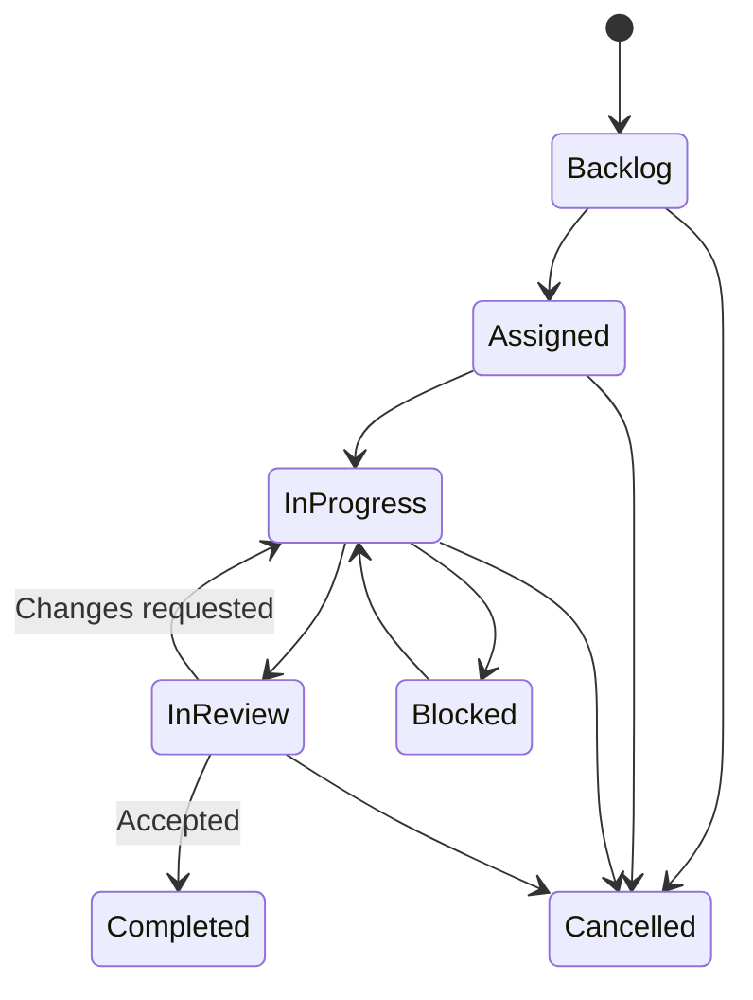
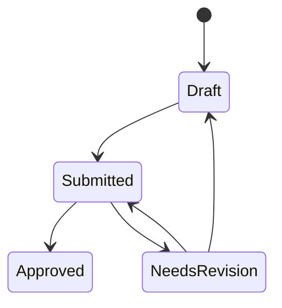

# Inhub Workspace — Workflow Specification

**Status:** Draft v1.0  
**Purpose:** Define task, report, invitation, review and notification lifecycles.

---

## 1. Workflow principles

- Every workflow has an owner, valid states and explicit transitions.
- Role and resource scope are evaluated before every transition.
- State changes are written by trusted backend operations.
- Important transitions create immutable activity/audit events.
- Notifications are generated from committed events, not from frontend assumptions.
- A failed email must not undo a successful task or report update.
- Workflows should be configurable later, but v1 must use a clear, tested baseline.

## 2. Task lifecycle — Module 2

### 2.1 Statuses

| Status | Meaning |
|---|---|
| Backlog | Captured but not yet committed for execution. |
| Assigned | An owner or responsible team has been identified. |
| In Progress | Work has started. |
| In Review | Work is submitted for review. |
| Completed | Deliverable has been accepted or task has been marked complete by an authorised user. |
| Blocked | Work cannot proceed due to a dependency or blocker. |
| Cancelled | Work has been stopped and will not be completed. |

### 2.2 Baseline transitions

Additional permitted transitions:

- Assigned may return to Backlog if assignment is withdrawn by an authorised Lead/Admin.
- In Review may return to In Progress when changes are requested.
- Completed may be reopened to In Progress by a Lead/Admin with a reason recorded.
- Cancelled tasks should not be reopened silently; an authorised user may explicitly reopen with an audit reason.

### 2.3 Transition permissions

| Transition/action | Admin | Lead | Team Member |
|---|---|---|---|
| Create task | Any scope | Authorised scope, if enabled | No by default |
| Backlog → Assigned | Yes | Scoped | No |
| Assigned → In Progress | Yes | Scoped | Assigned task only |
| In Progress → In Review | Yes | Scoped | Assigned task only |
| In Progress ↔ Blocked | Yes | Scoped | Assigned task, if enabled |
| In Review → Completed | Yes | Scoped reviewer | No |
| In Review → In Progress | Yes | Scoped reviewer | No |
| Reopen Completed/Cancelled | Yes | Scoped, with reason | No |
| Cancel task | Yes | Scoped, with reason | No |

### 2.4 Task creation requirements

A task should support:

- Title (required).
- Description/context.
- Workspace and optional project/workstream/team association.
- One accountable owner, with optional collaborators.
- Optional team assignment for shared ownership/visibility.
- Priority: Low, Medium, High, Urgent.
- Due date/time and configured timezone.
- Deliverable/acceptance criteria.
- Parent task and dependency links.
- Links to externally stored documents and deliverables. File uploads are outside the Firestore-only platform scope.

An accountable owner should be clear even when collaborators are added. If an entire team is assigned, a Lead should identify an accountable person before the task enters In Progress. This is a proposed operational rule.

### 2.5 Completion criteria

A task can be completed when:

- Required deliverables are recorded or linked.
- The actor has permission to complete/accept it.
- Required review has occurred, if the project/workflow requires review.
- The completion timestamp and actor are recorded.

Do not automatically mark a task complete solely because its due date passes or a work report mentions it.

## 3. Work report lifecycle — Module 3

### 3.1 Report cadence

The product supports daily work reports. Whether submission is mandatory every working day, only on days with activity, or configurable by Admin is an organisational policy decision. The application must not assume missing reports mean no work was performed.

### 3.2 Report states

| State | Meaning |
|---|---|
| Draft | Created but not submitted; editable by author. |
| Submitted | Submitted for Lead review; content is locked against silent edits. |
| Needs Revision | Reviewer has requested clarification or changes. |
| Approved | Reviewer has accepted the report. |

### 3.3 Report flow

A reviewer comment is required when returning a report for revision. Resubmission preserves the previous submitted version and review history.

### 3.4 Report fields

Report header:

- User ID.
- Reporting date in the organisation's timezone.
- Workspace/team context.
- State and timestamps.
- Reviewer and review outcome.

Report entries:

- Task reference, if applicable.
- Activity/work item.
- Work completed.
- Progress summary.
- Time spent in minutes, if time logging is enabled.
- Blockers.
- Next steps.
- Links to externally stored documents and deliverables. File uploads are outside the Firestore-only platform scope.

### 3.5 Review permissions

- A member can create/edit their own Draft and submit it.
- A member cannot approve their own report.
- A Lead can review reports within assigned scope.
- Admin can review any report.
- Every review action records reviewer, timestamp, decision and comment.

Whether all reports require approval is configurable only after the organisation decides the policy. Initial implementation should support the review workflow without making an unconfirmed attendance or hours policy mandatory.

## 4. Invitation and account lifecycle — Module 1

### 4.1 User states

| State | Meaning |
|---|---|
| Invited | Invitation sent; account setup not completed. |
| Active | User can authenticate and access authorised resources. |
| Suspended | Access temporarily blocked by Admin. |
| Deactivated | Access revoked; historical records retained. |
| Invitation Expired | Invitation token expired before activation. |

### 4.2 Invitation flow

1. Admin creates an invitation with email, intended role and initial scope.
2. Backend validates Admin permission and role/scope values.
3. Backend generates a unique, single-use, expiring invitation token.
4. Invitation event and delivery record are created.
5. Email provider sends the invitation.
6. Invitee opens the link and completes account setup.
7. Backend validates token, expiry, email and invitation state.
8. User profile is provisioned and invitation is consumed.
9. User receives an account activation/welcome notification.

Resending an invitation should invalidate or supersede the previous token. Tokens must never be logged in plain text.

### 4.3 Account changes

Role, team, workstream and account-status changes must be performed by Admin and logged. Affected users and relevant Leads may be notified according to event policy. Deactivation must revoke access without deleting historical data.

## 5. Notification event catalogue

### 5.1 Event-to-recipient matrix

| Event | In-app recipient | Email recipient | Default timing |
|---|---|---|---|
| User invited | Invitee | Invitee | Immediate |
| Invitation resent | Invitee | Invitee | Immediate |
| Account activated | User | User | Immediate |
| User suspended/deactivated | Affected user; Admin audit view | Affected user and Admin as configured | Immediate |
| Role changed | Affected user | Affected user | Immediate |
| Workstream/team assignment changed | Affected user; relevant Lead | Affected user and relevant Lead | Immediate |
| Task assigned | Assignee; relevant Lead activity | Assignee | Immediate |
| Task reassigned | New assignee; prior assignee; Lead activity | New assignee; prior assignee if appropriate | Immediate |
| Task status changed | Task participants | Configurable; avoid noisy emails for every minor change | In-app immediate; email by preference/rule |
| Task comment added | Mentioned users; task participants | Mentioned users | Immediate |
| User mentioned | Mentioned user | Mentioned user | Immediate |
| Task due soon | Assignee | Assignee; Lead optionally | Scheduled |
| Task overdue | Assignee; Lead | Assignee and Lead | Scheduled, deduplicated |
| Work report submitted | Reviewing Lead | Reviewing Lead | Immediate |
| Work report approved | Author | Author | Immediate |
| Work report needs revision | Author | Author | Immediate |

Only events for released modules should be enabled. Recipient selection must respect access scope and prevent disclosure to unrelated users.

### 5.2 Notification preferences

For non-essential operational emails, support:

- Immediate.
- Daily digest.
- Off.

In-app notifications have independent read/unread state. Essential security and account messages may be mandatory. Users should be able to choose event categories where supported.

### 5.3 Delivery behaviour

- Create notification records only after the underlying event is committed.
- Generate one delivery per recipient and channel.
- Use stable idempotency keys to avoid duplicates.
- Retry transient failures with bounded exponential backoff.
- Record provider response and delivery lifecycle.
- Do not block the initiating request on email delivery.
- Provide a direct link to the relevant authorised resource.
- Do not put sensitive content in email that the recipient is not authorised to view.

### 5.4 Sender identity

Proposed email sender: `Startup Weekend Workspace <no-reply@startupweekend.sbs>`. This is a sender identity, not a monitored mailbox. Configure domain verification, SPF/DKIM records and an optional reply-to address before production email is enabled.

## 6. Audit and event history

Important actions should generate audit records, including:

- Invitation creation, resend, acceptance and expiry.
- Role and scope changes.
- Account status changes.
- Workspace, workstream and team create/update/archive.
- Task create, assignment, field changes, transitions and completion.
- Report submit, revision request, resubmit and approval.
- Notification preference changes and administrative settings changes.

Audit records should include actor, event, resource, timestamp, request/event ID and relevant before/after values. Ordinary application users must not modify or delete audit records.

## 7. Scheduled workflows

Potential scheduled processes:

- Task due-soon reminders.
- Overdue task reminders.
- Daily digest generation.
- Work-report reminders, only after report cadence policy is approved.
- Invitation expiry cleanup.

Scheduled jobs must be idempotent, timezone-aware and safe to retry. They must not send the same reminder repeatedly for the same task/user/period unless the reminder policy explicitly allows it.

## 8. Error and exception handling

- Invalid state transition: reject with a clear validation error.
- Insufficient permission: return an access-denied response without disclosing protected resource details.
- Concurrent update: use transaction/precondition checks to avoid overwriting newer state.
- Email delivery failure: preserve the domain event, mark delivery failed/pending retry and surface operational status to Admin.
- Duplicate webhook/event: safely acknowledge or skip based on idempotency record.
- Deleted/archived scope: retain historical links and display archived context where the user is still permitted to view it.

## 9. Acceptance criteria

- [ ] Task transitions follow the defined state machine.
- [ ] Only authorised roles can perform each transition.
- [ ] Reopen/cancel actions record a reason.
- [ ] Submitted report content cannot be silently overwritten.
- [ ] Report revisions preserve review history.
- [ ] Invitation links are secure, single-use and expiring.
- [ ] Notification recipients are resolved from authoritative scope data.
- [ ] Duplicate event processing does not send duplicate emails.
- [ ] Email failures do not roll back successful business actions.
- [ ] Scheduled reminders are timezone-aware and deduplicated.
- [ ] Audit records exist for all critical workflow transitions.

---

## Appendix A — Implementation record (Module 1, 2026-11-19)

Original draft: `docs/supplied/workflow-specification.md`. Module 1 implements the invitation, account and notification workflows; task and report workflows arrive in Modules 2–3.

### A.1 Invitation

1. Admin opens **People → Invite person**, enters email, role, workspace and optional teams/workstreams.
2. Server validates (no duplicate active account, no duplicate pending invitation), creates the invitation, an audit entry and a `USER_INVITED` event in **one transaction**, and returns the link once so the Admin can copy it.
3. The outbox emails the link (when Resend is configured). Without Resend, the delivery is recorded as `failed / provider_not_configured` and the Admin copies the link manually; the UI says so.
4. **Resend** creates a new token and increments `tokenVersion`: old links stop working immediately.
5. **Revoke** marks it revoked and deletes the sealed token.
6. **Accept** (`/invite/[token]`): the invitee chooses their name and password; the server creates the Firebase user and profile, applies the pre-selected memberships, marks the invitation accepted, writes audit + `ACCOUNT_ACTIVATED`, and signs them in. The link works once.

### A.2 Account changes

Role change, suspend, deactivate and reactivate each run in a transaction with an audit entry and an event. Suspension/deactivation also disables the Firebase user and revokes refresh tokens. The affected person always gets an essential notification (email even while inactive).

### A.3 Structure and membership

Create/edit/archive workstreams and teams; link teams to workstreams; add members or Leads; remove; transfer a member between teams. Each change writes audit and, for membership changes, a `USER_TEAM_ASSIGNED` / `USER_WORKSTREAM_ASSIGNED` event that notifies the person and the current Leads of the affected scopes (not the actor).

### A.4 Feedback

Every action ends in an animated pop-up: success, or an error with a plain-language message. Destructive actions ask first in a confirmation dialog. Browser `alert/confirm` is never used.
